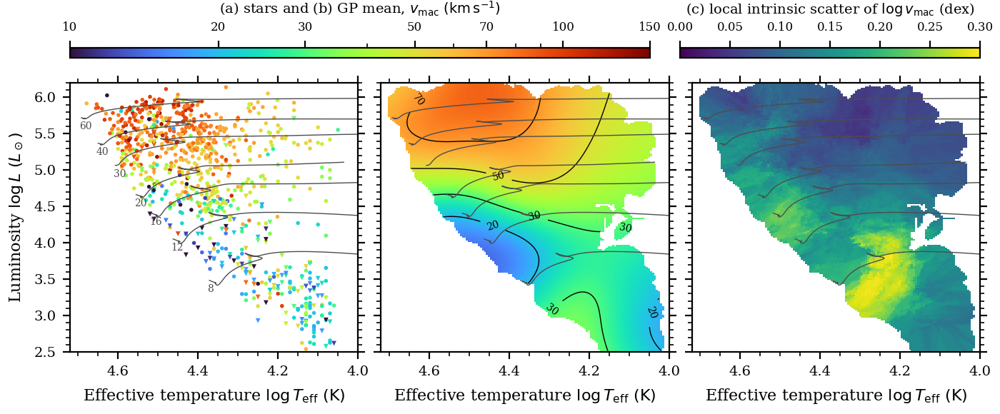

# Macroturbulence of Galactic OB stars on the (T_eff, log L) plane

Files in this folder:

| File | Contents |
|---|---|
| `iacob_vmac_mist.csv` | 890 Galactic OB stars with a measured macroturbulent velocity, their published parameters, and the luminosity, mass and evolutionary stage from MIST tracks |
| `vmac_fit_grid.csv` | Fit of log v_mac as a function of (log T_eff, log L): mean relation, its uncertainty, the intrinsic star-to-star scatter, and the data support |
| `fig_vmac_table.pdf/.png` | (a) the stars, (b) the mean relation, (c) the intrinsic scatter, with MIST tracks of 8–60 M☉ |
| `build_vmac_table.py` | Builds everything above (~20 s); needs the MIST tracks, see Section 6 |
| `input/` | The merged catalogue and the VizieR source tables (positions, upper-limit flags) |



## 1. The stars

All values come from published tables (VizieR), merged with one priority order. The IACOB-family sources agree with each
other to a median of ≤ 1 km/s per star where they overlap (pairwise MAD 3–8 km/s), so each star keeps one value from
the highest-priority source.

| Source | VizieR | Stars used | Notes |
|---|---|---|---|
| Simón-Díaz et al. 2017, A&A 597, A22 | `J/A+A/597/A22` | 382 | O and B stars; T_eff and log ℒ as published; v sin i from the Fourier transform (FT) method; **126 v_mac are upper limits** |
| de Burgos et al. 2024, A&A 687, A228 | `J/A+A/687/A228` | 376 | B supergiants; log ℒ from the published T_eff and log g |
| Holgado et al. 2018, A&A 613, A65 | `J/A+A/613/A65` | 62 | O stars; log ℒ from the published T_eff and log g |
| Holgado et al. 2022, A&A 665, A150 | `J/A+A/665/A150` | 58 | O stars not in the sources above; log ℒ as published |
| Burssens et al. 2020, A&A 639, A81 | `J/A+A/639/A81` | 12 | adopts IACOB values |

**Macroturbulence.** v_mac is the radial-tangential macroturbulent velocity ζ (Gray's model, equal radial and tangential
fractions), fitted together with v sin i to the profile of a metal line (or He line in the hottest stars) at high
resolution (R ≈ 25 000–85 000).

**Upper limits.** Simón-Díaz et al. (2017) flag 126 of their v_mac values as upper limits (column
`vmac_upper_limit` = 1). These are mostly faster rotators (median v sin i 112 km/s, against 51 km/s for measured
values) where macroturbulence cannot be separated from rotation. They are kept in the table and in the main fit
(Section 3).

**Spectroscopic luminosity.** The IACOB papers give the spectroscopic luminosity ℒ = T_eff⁴/g rather than L, because
it needs no distance. We use log(ℒ/ℒ☉) = 4 log T_eff − log g − log(5777⁴/27 400), with g in cgs. For a star of
mass M, ℒ/ℒ☉ = (L/L☉)/(M/M☉), so L follows from ℒ once the mass is known; Section 2 gets the mass from evolutionary
tracks.

## 2. Luminosity from MIST tracks

Each star's luminosity L, current mass, initial mass, radius and evolutionary stage come from its position on the
**spectroscopic** HRD (log T_eff, log ℒ), matched to stellar evolution tracks:

1. **Tracks.** MIST v1.2 (Choi et al. 2016; Dotter 2016), [Fe/H] = 0, rotating models with v/v_crit = 0.4 at the
   ZAMS, EEP format, all tracks between 2.4 and 150 M☉ (spaced by 0.2 M☉ below 8 M☉, 1 M☉ up to 20 M☉, 2 M☉ up to 40 M☉ and 5 M☉ above).
2. **Range of each track.** From the ZAMS (EEP 202) to the end of core helium burning (EEP 707): main sequence,
   post-main-sequence crossing and the blue/red supergiant stage.
3. **Finer mass grid.** Because EEPs mark the same evolutionary point on every track, tracks can be interpolated at
   fixed EEP. We interpolate linearly in log M between neighbouring tracks (log T_eff, log g, log L, log R, log age,
   log current mass) on a grid of initial masses from 3 to 150 M☉ in steps of 0.004 dex, about 211 000 model points.
   For each track we compute log ℒ from its T_eff and g with the normalisation above, and the fractional main-sequence
   age τ = age / age(TAMS, EEP 454).
4. **Matching.** Each star is assigned the nearest model point in the plane (log T_eff / 0.02, log ℒ / 0.10), i.e.
   distances measured in units of typical 1σ errors (0.02 dex in log T_eff, about ±1000–1500 K; 0.10 dex in log ℒ).
   Column `mist_dist` is that distance (median 0.04, maximum 0.46, so every star lies within the track coverage).
5. **Uncertainties.** 300 Monte Carlo draws per star, perturbing log T_eff and log ℒ by those 1σ errors and matching
   again. Columns `*_p16` and `*_p84` give the 16th and 84th percentiles. The median half-width of the log L
   interval is 0.14 dex. Column `frac_MS` is the fraction of draws that land on the main sequence. Near the TAMS a
   star can match either a main-sequence or a post-main-sequence point; L differs little between the two, but the
   mass and τ can.
6. **Check.** The same positions were matched earlier with an inverse-distance average of the 8 nearest track points.
   The two give the same log L to a median of 0.000 dex (MAD 0.008 dex) and the same initial mass to 0.01 dex.

What this luminosity is not: it is not based on distances or photometry. It assumes the star follows a single,
solar-metallicity, moderately rotating track, and its error is set mainly by the error in log g (which enters log ℒ
one to one). The relation L = ℒ M holds exactly for the model point, so if your luminosities are photometric you can
compare them directly with `logL_mist`, or place your stars on (log T_eff, log ℒ) if you have log g.

## 3. The fit v_mac(T_eff, log L)

**Model.** Gaussian-process regression of y = log₁₀ v_mac on x = (log T_eff, log L_MIST) for all 890 stars
(scikit-learn). Inputs and y are standardised; kernel = constant × Matérn (ν = 5/2, one length scale per axis) + white
noise. The white-noise term absorbs the real star-to-star scatter, so the GP mean is the smooth mean relation.
Fitted hyperparameters: length scales 2.1 (log T_eff) and 1.6 (log L) in standard deviations, i.e. a smooth
surface; white noise 0.19 dex. The rms residual of the stars about the mean is 0.19 dex.

**Intrinsic scatter.** The scatter is not uniform: it is about 0.09 dex above log L = 5 and 0.17–0.18 dex below 4.5,
largest among the mid-B stars (log T_eff 4.15–4.3, log L 3–4). `logvmac_scatter_local` is a robust standard
deviation (1.4826 × MAD) of the residuals of the 50 nearest stars, distances measured in units of (0.06 dex in
log T_eff, 0.25 dex in log L).

| log L | Stars | v_mac 16 / 50 / 84 % (km/s) | Local scatter (dex) |
|---|---|---|---|
| 3.0–4.0 | 136 | 16 / 24 / 47 | 0.18 |
| 4.0–4.5 | 63 | 15 / 27 / 46 | 0.17 |
| 4.5–5.0 | 162 | 29 / 44 / 59 | 0.13 |
| 5.0–5.5 | 244 | 50 / 64 / 84 | 0.09 |
| 5.5–6.2 | 255 | 58 / 79 / 98 | 0.09 |

**Grid columns** (`vmac_fit_grid.csv`; log T_eff 4.000–4.700 in steps of 0.005, log L 2.40–6.40 in steps of 0.02):

| Column | Meaning |
|---|---|
| `logTeff`, `logL` | grid point (K, L☉) |
| `logvmac_mean` | mean relation, log₁₀(v_mac / km s⁻¹) |
| `logvmac_mean_err` | 1σ uncertainty of the mean relation (dex), white noise excluded |
| `logvmac_scatter_local` | intrinsic star-to-star scatter at that position (dex) |
| `logvmac_mean_detections_only` | same fit without the 126 upper limits |
| `n_support` | stars within the ellipse of semi-axes 0.06 dex (log T_eff) and 0.25 dex (log L) |
| `ok` | 1 where `n_support` ≥ 3; outside, the fit is an extrapolation and should not be used |

**For a forward model,** draw each star's macroturbulence as

log v_mac ~ Normal( `logvmac_mean`, √(`logvmac_mean_err`² + `logvmac_scatter_local`²) ),

which reproduces both the trend and the spread at that position:

```python
import numpy as np, pandas as pd
from scipy.interpolate import RegularGridInterpolator

G = pd.read_csv('vmac_fit_grid.csv')
lt, ll = np.unique(G.logTeff), np.unique(G.logL)
grid = lambda c: RegularGridInterpolator((ll, lt), G[c].values.reshape(len(ll), len(lt)))
mean, err, scat, ok = (grid(c) for c in ['logvmac_mean', 'logvmac_mean_err', 'logvmac_scatter_local', 'ok'])

def draw_vmac(logTeff, logL, rng=np.random.default_rng()):
    p = np.column_stack([logL, logTeff])
    s = np.hypot(err(p), scat(p))
    return 10**(mean(p) + s * rng.standard_normal(len(p))), ok(p) > 0.5   # km/s, inside data coverage
```

## 4. Caveats

* **Slow rotators.** v_mac can be separated from rotation only when v sin i is not much larger than v_mac, so the
  sample is dominated by slow rotators (median v sin i 53 km/s). At fixed position, the residuals rise slightly with
  v sin i (+0.05 dex per dex in v sin i, Spearman ρ = +0.19), so extrapolating from 50 to 200 km/s adds about
  +0.03 dex. This is within the scatter, but untested for the fastest rotators.
* **Upper limits.** Treating the 126 limits as values lowers the mean relation by a median of 0.04 dex at
  log L 3.5–4.5 (at most 0.12 dex) and by ≤ 0.04 dex above 4.5, compared with fitting measured values only.
  Measured values alone are biased high, so the truth lies between the two columns.
* **Coverage.** Good above log L ≈ 4.3 and for B stars at log L 3–4; sparse for hot stars below log L ≈ 4.3
  (8–15 M☉ O/early-B dwarfs) and below log L ≈ 3. Use the `ok` mask.
* **Radial-tangential geometry.** v_mac is measured assuming equal radial and tangential fractions (A_R = A_T). The
  IACOB value itself changes by ≤ 6% if the real field is different, but the extra width it adds to a rotation-only
  v sin i fit depends strongly on the geometry: at R = 2000, k in v sin i_fit ≈ √(v sin i² + k² v_mac²) is ≈ 0.85 for
  A_R = A_T, 0.71–0.94 for A_R = 0.25–0.75, and ≈ 0.5 for purely tangential motions (as for gravity waves). See
  `../notebooks/vsini_macroturbulence.ipynb`, Section 8.
* **Metallicity.** Galactic stars only. In the LMC and SMC the onset of macroturbulence moves to higher luminosity.

## 5. Table columns (`iacob_vmac_mist.csv`, sorted by RA)

| Column | Units | Meaning |
|---|---|---|
| `star` | | Designation as in the source table |
| `ra`, `dec` | deg | ICRS J2000 position from VizieR (SIMBAD), for cross-matching |
| `sptype` | | Spectral type |
| `vmac_source` | | Source of v_mac, v sin i and T_eff (Section 1) |
| `Teff`, `logTeff` | K, dex | Effective temperature (Simón-Díaz 2017 give log T_eff to 0.01 dex; `Teff` is computed from it) |
| `logg` | cgs | Surface gravity, where published (de Burgos 2024, Holgado 2018/2022) |
| `logLspec` | ℒ☉ | Spectroscopic luminosity log(T_eff⁴/g) in solar units |
| `vmac` | km/s | Radial-tangential macroturbulence ζ |
| `vmac_upper_limit` | | 1 = upper limit (Simón-Díaz 2017) |
| `vsini` | km/s | Projected rotational velocity from the same source |
| `logL_mist`, `logL_mist_p16`, `logL_mist_p84` | L☉ | Luminosity from MIST and its 16–84 % interval |
| `Mini_mist`, `Mini_mist_p16`, `Mini_mist_p84` | M☉ | Initial mass and its 16–84 % interval |
| `M_mist` | M☉ | Current mass |
| `logR_mist` | R☉ | Radius |
| `tau_mist` | | Fractional main-sequence age (1 = TAMS; post-MS stars sit just above 1) |
| `phase_mist` | | `MS` or `post-MS` at the best match |
| `frac_MS` | | Fraction of Monte Carlo draws on the main sequence |
| `mist_dist` | | Distance to the matched model point in units of (0.02 dex, 0.10 dex) |
| `logvmac_fit` | dex | The fit (Section 3) at the star's position |
| `logvmac_scatter_local` | dex | Local intrinsic scatter at the star's position |

## 6. Rebuilding

```bash
pip install -r ../requirements.txt
# MIST v1.2 tracks, [Fe/H] = 0, v/v_crit = 0.4 (112 MB):
curl -LO https://mist.science/data/tarballs_v1.2/MIST_v1.2_feh_p0.00_afe_p0.0_vvcrit0.4_EEPS.txz
tar xJf MIST_v1.2_feh_p0.00_afe_p0.0_vvcrit0.4_EEPS.txz
MIST_DIR=$PWD/MIST_v1.2_feh_p0.00_afe_p0.0_vvcrit0.4_EEPS python build_vmac_table.py
```
